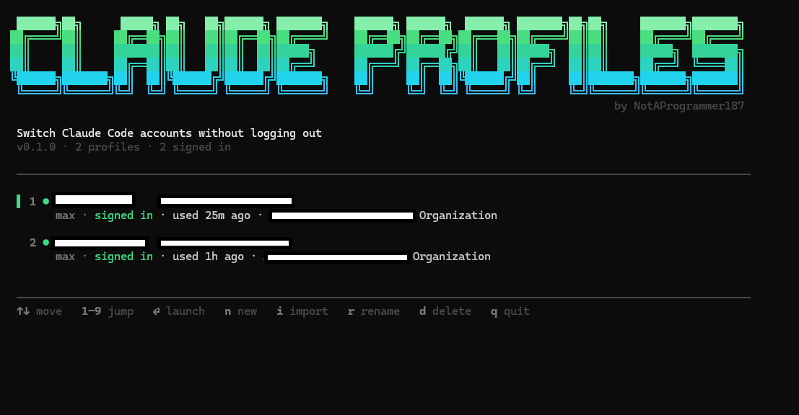
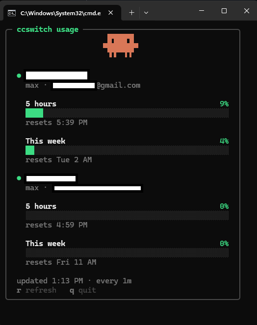

<h1 align="center">claude-code-profiles</h1>

<p align="center">
  <b>Switch between Claude Code accounts without logging out.</b><br>
  <code>ccswitch</code> gives every account its own config directory. Pick one and go.
</p>

<p align="center">
  <a href="https://github.com/NotAProgrammer187/claude-code-profiles/releases"></a>
  <a href="https://github.com/NotAProgrammer187/claude-code-profiles/actions/workflows/ci.yml"></a>
  <a href="LICENSE"></a>
</p>

<p align="center">
  <a href="#install">Install</a> ·
  <a href="#quick-start">Quick start</a> ·
  <a href="#commands">Commands</a> ·
  <a href="#features">Features</a> ·
  <a href="#pasting-screenshots">Pasting screenshots</a> ·
  <a href="#good-to-know">Good to know</a>
</p>



## Install

**Windows**

```powershell
irm https://raw.githubusercontent.com/NotAProgrammer187/claude-code-profiles/main/install.ps1 | iex
```

**macOS / Linux**

```sh
curl -fsSL https://raw.githubusercontent.com/NotAProgrammer187/claude-code-profiles/main/install.sh | sh
```

Open a new terminal and run `ccswitch`.

<details>
<summary>Other ways: Scoop, Homebrew, manual download, build from source</summary>

**Scoop** (no bucket needed, `scoop update ccswitch` keeps it current):

```powershell
scoop install https://raw.githubusercontent.com/NotAProgrammer187/claude-code-profiles/main/scoop/ccswitch.json
```

**Homebrew** (macOS Intel and Apple Silicon, Linux):

```sh
brew tap notaprogrammer187/ccswitch https://github.com/NotAProgrammer187/claude-code-profiles
brew install notaprogrammer187/ccswitch/ccswitch
```

**Manual download:** grab the binary for your system from the
[Releases page](https://github.com/NotAProgrammer187/claude-code-profiles/releases)
and put it on your PATH. On macOS and Linux, `chmod +x` it first.

**Build from source** (Go 1.22+):

```powershell
git clone https://github.com/NotAProgrammer187/claude-code-profiles
cd claude-code-profiles
.\build.ps1 -Install
```

</details>

The installers and `ccswitch upgrade` check every download against the
release's `SHA256SUMS` before installing it. Once a day, ccswitch tells you when
a newer ccswitch or Claude Code is out. Set `CCSWITCH_NO_UPDATE_CHECK=1` to
turn that off.

## Quick start

1. Run `ccswitch`.
2. Press **`i`** to import the account you're logged into now. You keep its
   settings, MCP servers and history.
3. Press **`n`** to add another account. It signs in the first time you
   launch it.
4. Pick a profile with **`↑↓`** and **`⏎`**. **`/`** filters and **`1`–`9`**
   jumps.

Each row shows how much of the account's rate limit is used
(`5h 42% · wk 12%`). Rows turn amber at 70% and red at 90%.

## Commands

**Launch**

| Command | What it does |
|---|---|
| `ccswitch` | Open the picker |
| `ccswitch run work` | Launch Claude Code as `work` |
| `ccswitch run --best` | Launch the account with the most rate-limit headroom |
| `ccswitch run work -- --resume` | Pass anything after `--` to `claude` |
| `ccswitch exec work -- code .` | Run any command as a profile |

**Usage**

| Command | What it does |
|---|---|
| `ccswitch usage` | Show every account's rate-limit use |
| `ccswitch usage --watch` | Live usage panel to keep beside Claude Code |
| `ccswitch statusline` | Account and usage for Claude Code's status line |

**Shells and folders**

| Command | What it does |
|---|---|
| `ccswitch use work` | Point this shell at a profile |
| `ccswitch init pwsh` | Shell integration and tab completion |
| `ccswitch link work` | Use `work` in this folder and below. Plain `ccswitch run` picks it up |
| `ccswitch unlink` · `ccswitch links` | Remove this folder's link · list links |

**Share your setup**

| Command | What it does |
|---|---|
| `ccswitch sync --from work` | Copy settings, MCP servers, skills and more into your other profiles |
| `ccswitch defaults set <key> <value>` | Keep one setting the same in every profile |

**Manage profiles**

| Command | What it does |
|---|---|
| `ccswitch new work` · `ccswitch import work` | Create an empty profile · copy your current `~/.claude` into one |
| `ccswitch rename old new` · `ccswitch rm work` | Rename · delete (asks first, `-y` skips) |
| `ccswitch list` · `ccswitch current` · `ccswitch where work` | List profiles · this shell's profile · a profile's folder |
| `ccswitch doctor` | Check the whole setup and say what to fix |
| `ccswitch upgrade` | Update ccswitch |

## Features

### Live usage panel

Run `ccswitch usage --watch` in a second terminal next to Claude Code and leave
it there.



- A meter for each account's 5-hour and weekly window, with reset times.
- Amber at 70%, red at 90%. When a window turns red, the terminal beeps and
  you get a desktop notification.
- Refreshes every minute (`--every 30s` to change it, 15s minimum). Press `r`
  to refresh now, `q` to quit.

### Always use the account with headroom

`ccswitch run --best` checks every signed-in account and launches the one
furthest from its limit. It tells you what it picked and why. Accounts it
can't read are skipped.

### Your account in the status line

Show which account a session runs as, right in Claude Code:

```powershell
ccswitch defaults set statusLine '{"type":"command","command":"ccswitch statusline"}'
```

```
work · Opus 4.5 · 5h 42% · wk 12%
```

It reads from a cache refreshed every two minutes, so the status line never
waits on the network.

### Run anything as a profile

```powershell
ccswitch exec work -- code .                       # VS Code signed in as work
ccswitch exec work -- claude mcp add github ...    # add an MCP server to work only
ccswitch exec --best -- claude -p "summarise this" # whichever account has headroom
ccswitch exec -- npm test                          # this folder's linked profile
```

Like `run`, it removes `ANTHROPIC_API_KEY` so your login is used, and it passes
the command's exit code back.

### Pin a shell to a profile

After this, every plain `claude` in that shell runs as `work`:

```powershell
Invoke-Expression (ccswitch use work)   # PowerShell
eval "$(ccswitch use work)"             # bash / zsh
```

Add shell integration once to skip the `eval` and get tab completion:

```sh
ccswitch init pwsh | Add-Content $PROFILE   # PowerShell
ccswitch init bash >> ~/.bashrc             # also: zsh, fish
```

### Share your setup between accounts

A new profile starts empty. `sync` copies your setup over:

```powershell
ccswitch sync --from work                      # into every other profile
ccswitch sync --from work --only settings,mcp  # just these parts
ccswitch sync --from work -n                   # preview, change nothing
```

It copies settings, keybindings, `CLAUDE.md`, commands, agents, skills, output
styles, hooks and MCP servers. Credentials and history are never copied. It
shows what it will change and asks first.

For a setting that should always match everywhere, share it instead:

```powershell
ccswitch defaults set remoteControlAtStartup false
ccswitch defaults                # what's shared
ccswitch defaults unset theme    # stop sharing it
```

Shared settings are written into every profile at launch, including brand-new
ones before their first login.

### Something's off? `ccswitch doctor`

One pass, one line per check:

```
ccswitch 0.1.7 on windows/amd64

  ok    binary — ~\bin\ccswitch.exe
  ok    claude — ~\AppData\Roaming\npm\claude.cmd
  warn  environment — ANTHROPIC_API_KEY is set — ccswitch strips it at launch, but a plain `claude` will bill the key instead of using your login
  ok    storage — ~\.ccswitch
  ok    state — ~\.ccswitch\state.json
  ok    work — you@work.com, signed in
  FAIL  personal — settings.json does not parse — fix it by hand; ccswitch won't touch a file it can't read

1 problem, 1 warning.
```

It only reads, never changes anything, and exits with code 1 when it finds a
problem.

## Pasting screenshots

Took a screenshot, hit paste in Claude Code, and got nothing? It isn't you,
and it isn't ccswitch. The image-paste key depends on your system:

| System | Paste an image with | Why the usual key fails |
|---|---|---|
| Windows | **Alt+V** | Windows Terminal takes Ctrl+V for its own paste, which only handles text |
| macOS | **Ctrl+V** (not Cmd+V) | Cmd+V is the terminal's paste, which only handles text |
| Linux | **Ctrl+V** | Needs `wl-clipboard` or `xclip` installed |
| WSL | **Ctrl+V** or **Alt+V** | Windows Terminal takes Ctrl+V, same as on Windows |

When Ctrl+V is the image key, it still pastes text if there's no image on the
clipboard (checked on Claude Code 2.1.331).

<details>
<summary><b>Windows:</b> make Ctrl+V paste images</summary>

**1. Let Ctrl+V through Windows Terminal.** In Settings, click *Open JSON
file*. Under `keybindings`, replace any `ctrl+v` paste entry with:

```json
{ "id": null, "keys": "ctrl+v" },
{ "id": "Terminal.PasteFromClipboard", "keys": "ctrl+shift+v" }
```

**2. Bind Ctrl+V in Claude Code.** Put this in
`~/.ccswitch/profiles/<name>/keybindings.json` (`/keybindings` opens it):

```json
{
  "bindings": [
    { "context": "Chat", "bindings": { "ctrl+v": "chat:imagePaste" } }
  ]
}
```

Then copy it to your other profiles with
`ccswitch sync --from <name> --only keybindings`.

Ctrl+V now pastes images and text. In Command Prompt, use Ctrl+Shift+V for
text.

**Drag and drop does nothing?** Windows Terminal ignores drops while it runs as
admin, which is always the case with UAC turned off. Copy the file's path
instead (Ctrl+Shift+C in Explorer) and paste that.

</details>

<details>
<summary><b>macOS</b></summary>

Nothing to set up. Use Ctrl+V for images and Cmd+V for text.
Cmd+Ctrl+Shift+4 puts a screenshot on the clipboard. Dragging an image file in
works too.

</details>

<details>
<summary><b>Linux</b></summary>

Install the clipboard tool for your session. Without one, image paste finds
nothing and doesn't tell you why.

```sh
sudo apt install wl-clipboard   # Wayland (most GNOME and KDE desktops)
sudo apt install xclip          # X11
```

The package names are the same on `dnf` and `pacman`. If your terminal pastes
on Ctrl+V, rebind that to Ctrl+Shift+V so the key reaches Claude Code.

</details>

<details>
<summary><b>WSL</b></summary>

Both keys already paste images from the Windows clipboard. Alt+V works as is.
For Ctrl+V, do step 1 from the Windows section.

</details>

## How it works

Claude Code keeps everything in one directory, chosen by `CLAUDE_CONFIG_DIR`:
your login, settings, MCP servers and history. A ccswitch profile is just one
of those directories. Launching a profile sets `CLAUDE_CONFIG_DIR` for that one
process.

Nothing is copied when you switch, so logins can't overwrite each other and
you can run several accounts at once in different terminals. It works with any
account Claude Code can sign into (Pro, Max, Team, Enterprise or an API key),
and you can have as many profiles as you like.

## Good to know

- **Restart to switch.** A running session keeps the account it started with.
- **API keys are removed.** `ANTHROPIC_API_KEY` and `ANTHROPIC_AUTH_TOKEN`
  would override your login, so ccswitch removes them at launch and warns you.
- **macOS isolation is partial.** Credentials live in the Keychain there.
  ccswitch is built for Windows first.
- **Keep `~/.ccswitch` private.** Profiles hold live login tokens. Don't put
  the folder in cloud sync or commit it anywhere.
- **More accounts don't mean more capacity.** Each profile is a real account
  that signs in normally. ccswitch doesn't get around any account's usage
  limits or billing. Following Anthropic's Terms of Service and Usage Policy is
  your responsibility.

## Disclaimer

This is an independent, community project. It is **not affiliated with, endorsed
by, or sponsored by Anthropic**. "Claude" and "Claude Code" are trademarks of
Anthropic, PBC, used here only nominatively to describe what this tool
interoperates with.

ccswitch runs entirely on your machine, stores nothing on any server, ships no
Anthropic code, and does not circumvent Claude Code's authentication or billing.
Use of Claude Code through ccswitch remains subject to Anthropic's own Terms of
Service and Usage Policy, and complying with them is your responsibility.

## License

MIT. See [LICENSE](LICENSE). Provided "as is", without warranty of any kind.
